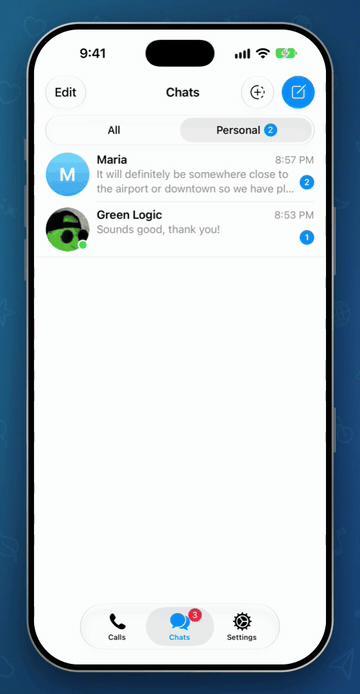
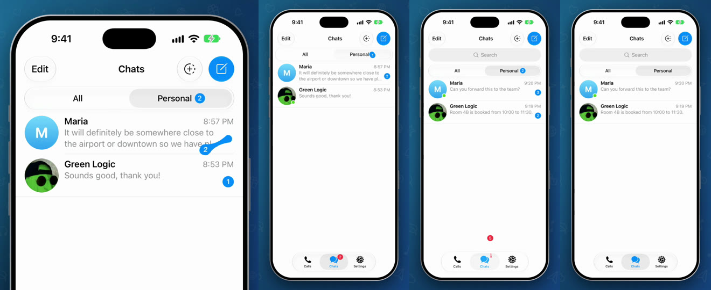

# Stretchy Unread Badge

Marking a chat as read in Telegram takes a swipe, or a long press and a menu. Here you just grab the
counter and pull. It stretches out of its place like a drop of liquid, the neck snaps, and if you let go
far enough away it pops and the chat is read. Let go early and it springs back.

It works in three places: on a chat, on a folder, and on the red total on the Chats tab.

This is a patch for the real Telegram for iOS, not a mock-up. The video was recorded from the app built
with this code, on a real account, and every pop really marks the messages as read.

<p align="center">
  
</p>

▶︎ [Media/demo.mp4](Media/demo.mp4) is the full video (22 seconds).



## Where each part is

Everything sits at the same path it has inside Telegram-iOS, so `submodules/` can be copied straight
over a checkout.

### New files

| Part | File | What it does |
|---|---|---|
| The liquid effect | [`StretchyBadgeController.swift`](submodules/TelegramUI/Components/StretchyBadge/Sources/StretchyBadgeController.swift) | Draws the neck between the counter and the spot it left, then the snap, the spring back, the pop and the droplets. |
| Grabbing a counter | [`StretchyBadgeDragRecognizer.swift`](submodules/TelegramUI/Components/StretchyBadge/Sources/StretchyBadgeDragRecognizer.swift) | Takes the touch away from scrolling, swiping and menus when it starts on a counter. Taps still go through. |
| Chat rows | [`ChatListItemStretchyBadge.swift`](submodules/ChatListUI/Sources/Node/ChatListItemStretchyBadge.swift) | Attaches the drag to each chat in the list. A pop marks that chat as read. |
| Bazel target | [`BUILD`](submodules/TelegramUI/Components/StretchyBadge/BUILD) | The `StretchyBadge` module. |

### Changes to Telegram's own files

One patch per part. They touch different files, so the order doesn't matter.

| Part | Patch | Files | What changes |
|---|---|---|---|
| Chat rows | [`01-chat-rows.patch`](patches/01-chat-rows.patch) | `ChatListItem.swift`, `ChatListUI/BUILD` | Calls the new row code when a row lays out, and stops a press on the counter from opening the chat preview. |
| Red total | [`02-chats-tab-red-total.patch`](patches/02-chats-tab-red-total.patch) | `TabBarComponent.swift`, its `BUILD` | Makes the red counter on a tab draggable. |
| Folders | [`03-folder-counters.patch`](patches/03-folder-counters.patch) | `HorizontalTabsComponent.swift`, its `BUILD`, `ChatListControllerNode.swift` | Makes the counter on a folder draggable. |
| Marking as read | [`04-marking-as-read.patch`](patches/04-marking-as-read.patch) | `ChatListController.swift` | Decides what a pop on the red total or on a folder does. |

## How it works

**The neck.** When a drag starts, the real counter is hidden and a copy follows the finger. The counter
and the empty spot it left are two circles joined into one outline with arcs and cubic curves
(`gooeyPath`), so there's no seam where they meet. The further you pull, the more the home circle
shrinks (up to 40%) and the thinner the neck gets.

**The snap.** Past 56 pt the neck shoots back into its place in 0.16 s, with a light haptic and a small
wobble on the counter.

**Letting go.** After a snap, more than 30 pt from home, the counter bursts into droplets and a ring, a
medium haptic plays and the messages are read. Closer than that it flies home and lands with a squash.
A short pull that never snapped springs back with the neck still attached.

**Grabbing it.** A counter is tiny, and the list underneath wants the same touch for scrolling, swiping,
switching folders and long-press menus. `StretchyBadgeDragRecognizer` watches for a touch that starts
near a counter and takes it after 3 pt of movement. Long-press menus are switched off only for touches
on a counter, so a finger that rests for a moment before pulling doesn't open one.

**What a pop does.** Nothing new on the data side. Each pop makes the same call Telegram already has:

| Where | Same as | Call |
|---|---|---|
| A chat | "Mark as Read" in the chat's menu | `togglePeersUnreadMarkInteractively` |
| A folder | "Read All" in the folder's menu | `readAllInFilter(id:)` |
| The red total | Reading every chat in the main list | `markAllChatsAsReadInteractively` |

## Try it

This applies to Telegram-iOS at commit `24638bc69bd083981b178dd1e7f921eebbf7fc46`.

```sh
git clone --recursive https://github.com/TelegramMessenger/Telegram-iOS.git
cd Telegram-iOS
git checkout 24638bc69bd083981b178dd1e7f921eebbf7fc46
git submodule update --init --recursive

git clone https://github.com/Amithkodjj/telegram-stretchy-unread-badge.git ../stretchy
cp -R ../stretchy/submodules/. submodules/
git apply ../stretchy/patches/*.patch
```

Then build it the way [Telegram's README](https://github.com/TelegramMessenger/Telegram-iOS#readme)
describes, with your own `api_id`. This repo compiles on its own against that commit, without the paper
plane patch.

## Numbers to play with

| Value | Default | Where | Meaning |
|---|---|---|---|
| `snapDistance` | 56 pt | `StretchyBadgeDragRecognizer.handleDrag` | The neck snaps past this distance |
| `popDistance` | 30 pt | `StretchyBadgeDragRecognizer.handleDrag` | After a snap, let go farther than this to pop |
| `startDistance` | 3 pt | `StretchyBadgeDragRecognizer` | How far the finger moves before the drag starts |
| Grab area, chat | 18 × 14 pt | `ChatListItemStretchyBadge.swift` | Extra room around the counter |
| Grab area, folder | 12 × 12 pt | `HorizontalTabsComponent.swift` | Extra room around the counter |
| Grab area, red total | 22 × 20 pt | `TabBarComponent.swift` | Extra room around the counter |

## Notes and limits

* A long press right on a counter no longer opens a menu. Anywhere else on the row, folder or tab it
  still does.
* Popping the red total reads every chat in the main list right away, with no confirmation step.
* The drag follows the finger, so Reduce Motion doesn't change it.
* Tested on the iOS 27.2 Simulator (iPhone 18 Pro) in a debug build. It hasn't been run on a physical
  iPhone yet.

Built on [Telegram-iOS](https://github.com/TelegramMessenger/Telegram-iOS) and published to follow its
licence terms. Paper plane forwarding is a separate project in its own repository.
